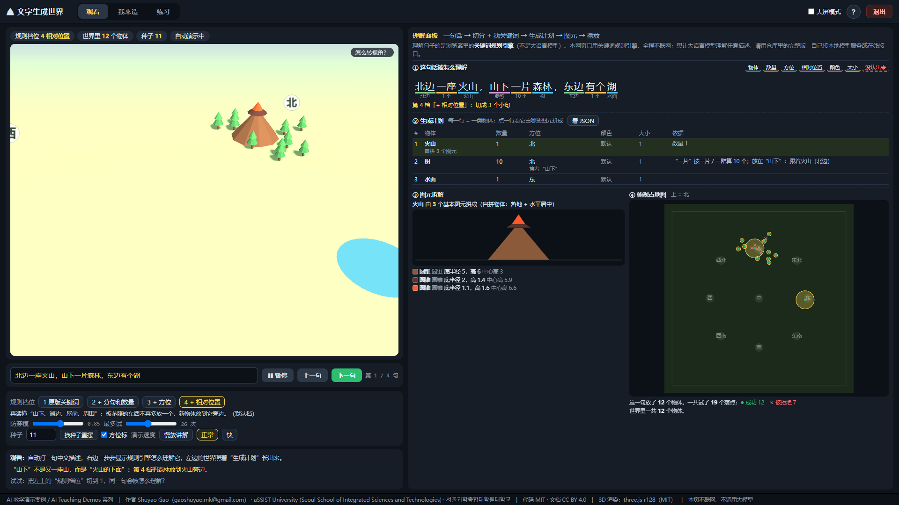
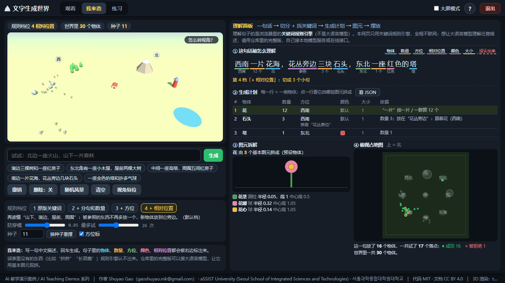
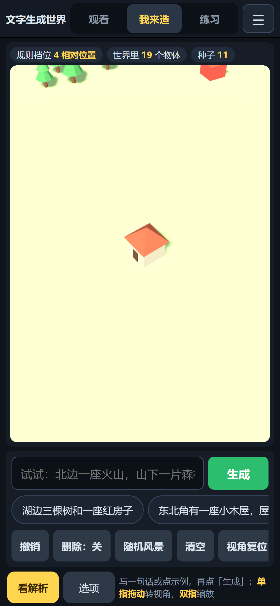

> **AI 教学演示案例 / AI Teaching Demos** 系列

# 文字生成世界 · Text to 3D World

**Shuyao Gao**（gaoshuyao.mk@gmail.com）· aSSIST University (Seoul School of Integrated Sciences and Technologies) · 서울과학종합대학원대학교
代码 MIT · 文档与教学素材 CC BY 4.0

写一句中文描述，比如“北边一座火山，山下一片森林，东边有个湖”，网页就把它拆成**物体、数量、方位、相对位置**，变成一份“生成计划”，再用圆锥、圆柱、立方体、球这些基本图元在 3D 场景里摆出来。旁边的**理解面板**把每一步摊开给你看。电脑和手机都能直接打开：不安装、不联网，所有计算都在你的浏览器里完成。



> 网页版只用浏览器里的**关键词规则引擎**理解句子，不调用任何大模型，也不联网。想让大语言模型理解任意描述，见下面的「完整版」。

## 怎么打开（不用安装，也不用联网）

- **手机**：打开在线链接 <https://shuyaogao.github.io/text-to-3d-world/>（竖屏）。
- **电脑**：打开同一个在线链接 <https://shuyaogao.github.io/text-to-3d-world/>；
  或在 [Releases](https://github.com/ShuyaoGao/text-to-3d-world/releases) 下载 `text-to-3d-world-v1.0.zip`，解压后双击 `index.html`；
  或仓库首页点 **Code → Download ZIP**，解压后双击 `play/index.html`。

Windows 用自带的 Edge 打开，Mac 用 Safari 打开（Safari 需要在真实 Mac 上确认，见“测试情况”）。**一定要先解压**，不要在压缩包里直接双击。

## 怎么用

页面顶部有三个模式标签，打开时默认是「观看」：

| 模式 | 你能做什么 |
|---|---|
| **观看** | 自动打 4 句示例描述，一句一句生成世界，并说明每句的看点。可以暂停、上一句 / 下一句；演示速度 3 档（慢放讲解 / 正常 / 快） |
| **我来造** | 自己写一句话生成；下面有示例句子可以一点就填。撤销、点选删除、随机风景、清空、视角复位 |
| **练习** | 8 项任务清单（种树林、用方位词、指定数量、上色、相对位置、对照原版规则、看被拒绝的落点、删除物体），完成一项自动打勾 |

**规则档位**有 4 档，从项目原版的引擎开始，一档加一条规则：

| 档位 | 能力 |
|---|---|
| 1 原版关键词 | 和项目原来的离线引擎完全一样：整句里出现了哪些物体词就放哪些，同一类只放一次；方位、数量都不管，位置随机 |
| 2 + 分句和数量 | 按逗号、“和”把句子切成小句；最长匹配物体词（“火山”不会被当成“山”）；读出数量、大小、颜色 |
| 3 + 方位 | 读出“北边、东南角、中间”等方位词，放到地图上对应的区域 |
| 4 + 相对位置（默认） | 读懂“山下、湖边、屋前、周围”：被参照的东西不再多放一个，新物体放到它旁边 |

同一句话切换档位，世界马上按新规则重摆，最适合讲“规则系统是怎么一条条长出来的”。摆放还有两个细调滑块（防穿模系数、每个物体最多试几次）和一个随机种子：**同一句话、同一档位、同一种子，摆出来的世界完全一样**。

**理解面板**：

1. **这句话被怎么理解**：每个词按角色上色（物体 / 数量 / 方位 / 相对位置 / 颜色 / 大小 / 没认出来），小句之间用竖线隔开，下面写着这一档的规则和注意事项。
2. **生成计划**：每一行是一类物体（数量、方位、颜色、大小、依据）；「看 JSON」显示引擎交给 3D 场景的原始计划，格式和完整版里大语言模型输出的相同。
3. **图元拆解**：点计划里的一行（或者点 3D 画面里的物体），看它由哪几个基本图元拼成，以及按真实尺寸画的侧视图。
4. **俯视占地图**：从正上方看每个物体的占地圆；黄色是这一句新放的，绿点是采用的落点，红 × 是因为和已有物体重叠而被拒绝的落点。

### 电脑（键盘鼠标）

左栏上方是 3D 世界，下方是输入框、示例句子、规则档位和说明；右栏是理解面板。右上角「大屏模式」把右栏放大（左右比例 45:55 → 35:65），适合投影。

| 按键 | 作用 |
|---|---|
| 回车 | 我来造 / 练习：生成 |
| 拖动 / 滚轮 / W A S D | 转视角 / 缩放 / 走动（在输入框里打字时不会触发） |
| 空格、N | 观看：暂停 / 继续、下一句 |
| 1 / 2 / 3 | 切换到观看 / 我来造 / 练习 |
| B | 大屏模式 |
| H 或右上角 ? | 再看一次操作说明 |



### 手机（触屏，竖屏）

头部一行：标题、三个模式标签、☰ 菜单（操作说明、看解析、选项与任务、视角复位、退出都收在菜单里）。

- **观看**：3D 世界贴顶，往下滑依次是播放控制、理解面板（紧凑画法）、规则档位和说明。
- **我来造 / 练习**：一屏不滚动。上方是 3D 世界：**单指拖动**转视角，**双指张合**缩放，点一下物体看它的图元；下方是输入框 + 大的「生成」按钮，示例句子可以左右滑动、点一下就填进输入框，再往下一行是撤销 / 删除 / 随机风景 / 清空 / 视角复位。「看解析」把理解面板全屏打开，「选项」（练习模式下是「任务」）全屏打开规则档位、滑块和任务清单，都用底部的「返回」关闭。
- 横屏时会提示“竖屏体验更佳”，也可以选择仍然横屏继续。
- 第一次打开的操作说明在触屏上显示触屏图解，不显示键盘图。



## 课堂上怎么用（推荐顺序，约 15 分钟）

1. **观看第 1 句（3 分钟）**：先看理解面板①，讲“理解”就是给每个词贴标签：哪个是物体、哪个是数量、哪个是方位。再看②，生成计划就是一张表。
2. **同一句话切档位（4 分钟）**：把规则档位从 4 切到 1，再切到 2、3。第 1 档只认物体，第 2 档多出一座“山”（把“山下”当成了山），第 3 档有了方位，第 4 档才把森林放到火山旁边。讨论：每加一条规则解决了什么，又可能引入什么新问题？
3. **看第 4 句的“拱桥”（2 分钟）**：词表里没有的东西，规则引擎只能跳过。这就是规则系统的边界，也是为什么要用大语言模型（完整版）。
4. **我来造（4 分钟）**：请同学出题，现场写句子；故意写一句规则会理解错的话，看面板里哪一步出了错。同学也可以用自己的手机打开在线链接一起试。
5. **俯视图里的拒绝采样（2 分钟）**：把“防穿模”调到 1.2 以上，再种“十五棵树”，看红 × 变多。
6. **练习**：课后自己把 8 项任务做完。

讨论题：

1. 写一句让第 4 档也理解错的话（提示：“山上的湖”“两座房子之间有一棵树”）。要让规则理解它，需要再加一条什么规则？规则越加越多，会遇到什么麻烦？
2. 大语言模型不需要这些规则也能输出同样格式的 JSON 计划。它的好处是什么？换来了哪些新的问题（比如每次结果不一样、要联网或要显卡、会“编”出奇怪的形状）？
3. 拒绝采样：为什么试满次数后要“硬放”？如果不硬放，会发生什么？

## 它是怎么做的

```
一句话 ──► 切成小句 ──► 最长匹配物体词 ──► 读数量 / 大小 / 颜色 / 方位 / 相对位置 ──► 生成计划 JSON
                                                                                      │
3D 场景 ◄── 每个物体 = 基本图元的组合（预设 or 自拼）◄── 拒绝采样找落点（不重叠）◄──────┘
```

- **规则引擎**（`play/js/planner.js`）：词表 15 类、92 个词（中文为主，也认一些英文词）。第 1 档原样照搬原版的 12 条关键词规则。数量支持中文数字、阿拉伯数字和量词，“一片 / 一群 / 许多”按每类物体预设的个数放，最多 15 个。
- **图元**（`play/js/shapes.js`）：12 种预设物体（树、房子、塔、山、水面、石头、花、小人、方块、球、圆柱、圆锥），每种由 1–3 个基本图元拼成；火山是“自拼物体”（3 个圆锥），格式和完整版里让大模型现拼的物体一样（最多 14 个零件，最后整体落地、水平居中）。
- **摆放**（`play/js/world.js`）：方位 → 区域中心，散布半径 = 3 + 数量 × 0.9；每个物体先量占地半径，再随机找落点，两个占地圆心的距离必须大于（半径之和 × 0.85），最多试 26 次，试满就在附近硬放。随机数用固定种子（观看模式第 i 句用种子 11 + i）。
- **3D**（`play/js/scene3d.js`）：three.js r128，灯光、雾、生长动画、昼夜、树木摇曳、水面起伏、小人散步都沿用原版。视角操作用 Pointer Events：鼠标和手指都是单指拖动转视角，双指张合缩放；所有手指离开或窗口失焦时复位。
- **手机布局**（`play/css/mobile.css`、`play/js/mobile.js`）：触屏且宽度 ≤ 980px 时给 body 加 `touchp`，所有手机样式挂在它下面，电脑布局不受影响。
- **例子**：“北边一座火山，山下一片森林，东边有个湖”
  - 第 1 档（原版）：火山（自拼） ×1；树 ×10；山 ×1；水面 ×1，全部随机摆放；
  - 第 4 档：火山（自拼） ×1（北）；树 ×10（北，挨着“山下”）；水面 ×1（东）。
- **演示句子的统计**（`results/result.json`，由 `node tools/plan_report.js` 用和网页同一份代码生成，默认摆放参数）：

| 句子 | 档位 | 计划里的物体类数 | 放下的物体 | 落点尝试 / 被拒绝 | 没认出来的词 |
|---|---|---|---|---|---|
| 北边一座火山，山下一片森林，东边有个湖 | 1 | 4 | 13 | 24 / 11 | — |
| 北边一座火山，山下一片森林，东边有个湖 | 4 | 3 | 12 | 19 / 7 | — |
| 中间一座高塔，周围五间红房子，南边几个人在散步 | 1 | 3 | 4 | 4 / 0 | — |
| 中间一座高塔，周围五间红房子，南边几个人在散步 | 4 | 3 | 10 | 15 / 5 | — |
| 西南有一片花海，花丛旁边三块石头，东北一座雪山 | 1 | 4 | 14 | 14 / 0 | — |
| 西南有一片花海，花丛旁边三块石头，东北一座雪山 | 4 | 3 | 16 | 21 / 5 | — |
| 河上有一座拱桥，岸边两棵大树 | 1 | 2 | 4 | 4 / 0 | — |
| 河上有一座拱桥，岸边两棵大树 | 4 | 2 | 3 | 9 / 6 | 拱桥 |

- **测试**（`tests/`）锁住与原版的对应关系：
  - 第 1 档对一组句子的输出 = 原版页面里的关键词引擎（测试直接从原版页面里取出那段代码来运行对照）；
  - 每种预设物体的每个零件（几何参数、位置、旋转、材质、颜色、阴影）= 原版的 BUILD；自拼物体 = 原版的 buildCustom；
  - 第 2–4 档的分句、数量、方位、相对位置；摆放不越界、不重叠、同种子可复现；
  - 页面不联网（没有 fetch、CDN、module），每个脚本都在，手机布局文件都接上了，体积不超标；浏览器验收见下文。

### 和原版页面的关系

`app/index_full.html` 是项目原来的页面（只把 three.js 的路径指到 `play/vendor/`）。网页版 `play/` 在它的基础上：

- 去掉了连接本机模型服务和填写在线接口密钥的部分，只留关键词规则引擎，因此完全离线；
- 加了第 2–4 档规则、理解面板、三种模式、帮助、练习、退出按钮和手机竖屏布局；
- 随机摆放改用固定种子；原版里 W / S、A / D 走动方向是反的，网页版已改正；水面起伏改成只在地面以上（原版会沉到地面以下、出现闪烁）；视角距离从 46 调到 50，适应左右两栏里较窄的画面。

### 这个案例里有没有神经网络？

网页版**没有**：理解句子的是规则，摆放是随机采样，没有训练过任何模型，所以面板是“理解面板”，不是神经网络的“大脑面板”。完整版可以接大语言模型（第三方模型，不是本仓库训练的），它对网页来说是黑盒，只交回一份 JSON 计划。

## 完整版：让大语言模型理解任意描述

`app/index_full.html` 可以把句子交给大语言模型，让它用基本图元现拼词表里没有的东西（“长颈鹿”“拱桥”）。它**需要联网或本机模型服务**，所以不放进 `play/`：

- **本机模型服务**：装好 [Ollama](https://ollama.com) 后拉一个模型（页面默认填的是 `qwen3:4b`），并允许网页跨域访问：Windows 先运行 `set OLLAMA_ORIGINS=*` 再 `ollama serve`，Mac / Linux 用 `OLLAMA_ORIGINS=* ollama serve`。然后双击 `app/index_full.html`，引擎选“本地 Ollama”，圆点变绿即可。小模型认得的词走关键词引擎，没见过的词才交给模型现编（约 20–40 秒）。
- **在线接口**：引擎选“云端 API”，填任意 OpenAI 兼容接口的地址、密钥和模型名，整句交给模型规划。密钥只保存在你自己浏览器的本地存储里，页面不会发给除你填的地址以外的任何地方；用公用电脑时用完请清空。

模型名和价格变化很快，使用前请到对应服务的官网核对。

## 想自己修改

网页本身不需要构建，直接改 `play/` 里的文件、刷新即可。名称、档位说明、演示句子、练习任务都集中在 `play/js/config.js`。

```bash
# 重新生成署名、results/result.json（需要 Node.js）、完整版和发布包（play/ + 根目录 index.html）
python -m tools.build --release

# 测试：Python 3.10+ 和 pytest；JS 测试需要 Node.js
pip install -r requirements.txt
python -m pytest

# 浏览器验收（需要本机装有 Edge 或 Chrome 和 pip install playwright；不下载任何浏览器）
python -m tools.browser_check --shots docs/img       # 电脑尺寸的页面自检 + 截图 -> results/browser_check.json
python -m tools.mobile_check_ttw --shots docs/img    # 手机 / 平板 / 横屏 / 电脑尺寸的场景验收 + 截图 -> results/mobile_check.json
TTW_BROWSER_TEST=1 python -m pytest tests/test_browser.py   # 同样的两项，作为 pytest
```

署名、联系邮箱、系列名、仓库名都集中在 `credits.json`；改完运行 `python -m tools.fill_credits --release`，会重新生成 README、CITATION.cff、LICENSE、LICENSE-docs、根目录 index.html、页面页脚和发布包。

## 目录结构

```
index.html                跳转页：打开仓库根目录（GitHub Pages）或解压发布包后双击它，自动转到 play/
.nojekyll                 让 GitHub Pages 原样发布，不走 Jekyll
play/                     网页（双击 index.html）
  index.html
  css/app.css             电脑布局
  css/mobile.css          手机竖屏布局（body.touchp 下）
  js/config.js            名称、档位、演示句子、练习任务（集中在这一个文件）
  js/planner.js           关键词规则引擎（4 档）
  js/shapes.js            物体 = 基本图元的组合
  js/world.js             摆放（区域中心 + 拒绝采样，固定种子）
  js/scene3d.js           3D 场景、视角操作（鼠标 / 单指 / 双指）与动效
  js/panel.js             理解面板
  js/mobile.js            手机：设备分类、☰ 菜单、全屏面板、横屏提示、防误触
  js/app.js               页面逻辑（三种模式、帮助、练习、退出、自检）
  js/credits.js           署名（由 credits.json 生成）
  vendor/three.min.js     three.js r128（MIT，许可证在同目录）
app/index_full.html       完整版：可接本机模型服务或在线接口（会联网）
results/result.json       演示句子的理解结果与摆放统计（README 中的数字都来自这里）
results/browser_check.json   电脑尺寸页面自检的结果
results/mobile_check.json    手机 / 电脑尺寸场景验收的结果
tools/                    构建、统计、浏览器验收（browser_check / mobile_check / mobile_check_ttw）、署名填充
tests/                    与原版逐项对照的测试、静态检查、浏览器验收
docs/img/                 截图
```

## 常见问题

- **关掉页面后还有程序在跑吗？** 没有。这是纯静态网页，关掉标签页就全部结束，不留任何后台进程。「退出」（电脑右上角，手机在 ☰ 菜单里）会先停止所有计算并释放 3D 画面，再尝试关闭标签页；浏览器不允许关闭时，会显示“已停止运行”。
- **3D 画面是空白，写着没能启动 WebGL？** 浏览器或显卡驱动关闭了 3D 加速。换最新版 Edge / Chrome / Safari 再试；理解面板不受影响。
- **我写的东西没出来？** 看理解面板①里有没有虚线标出的“没认出来”。网页版只认词表里的词，完整版才能接大模型现拼。
- **手机上怎么看理解面板？** 观看模式往下滑就是；我来造 / 练习模式点「看解析」全屏打开，「返回」关闭。
- **世界会保存吗？** 「我来造」的世界保存在你自己浏览器的本地存储里，刷新后还在；「清空」即可删除。

## 测试情况与已知限制

- Microsoft Edge 155.0.4283.45（Playwright 驱动，无头，WebGL 用软件渲染）：在 1920×1080、1366×768 两种窗口大小下跑过页面自检（三种模式、4 个规则档位、撤销 / 删除 / 随机风景 / 清空、大屏模式、帮助、退出，共 24 项检查），没有 JS 报错、没有横向溢出（`results/browser_check.json`）。
- 手机 / 平板用 DevTools 协议模拟（设备尺寸、DPR、触屏，不是改窗口大小）：竖屏 390×844（DPR 3）、414×896（DPR 3）、360×780（DPR 3）、768×1024（DPR 2），横屏 844×390（DPR 3），再加电脑 1920×1080、1366×768，7 个尺寸全部通过（每个竖屏尺寸 64 项场景检查：没有横向溢出、我来造一屏不滚动、点示例句子再点「生成」物体变多、单指拖动转视角、双指缩放、面板和菜单能开关、触控区 ≥ 44px、没有 JS 报错；`results/mobile_check.json`）。
- Chrome 与 Edge 内核相同，但没有单独测；Firefox 未测。
- **Safari（Mac）和真实手机（iPhone / 安卓）需要实机确认**，目前只做了模拟。
- 规则引擎只是演示：它不懂否定（“没有树”）、比较（“比塔还高”）和复杂的空间关系（“两座房子之间”）。

## 许可证与引用

代码 MIT（见 `LICENSE`），文档与教学素材（README、截图、页面文字）CC BY 4.0（见 `LICENSE-docs`），使用请注明出处。引用信息见 `CITATION.cff`（GitHub 页面右侧的 “Cite this repository”）。第三方组件说明见 `THIRD_PARTY.md`。联系作者：gaoshuyao.mk@gmail.com。

## AI 辅助开发声明

代码由 Claude Code 辅助编写，经作者审阅。

## English summary

**Text to 3D World** is a browser-only teaching demo from the AI Teaching Demos series by Shuyao Gao (aSSIST University (Seoul School of Integrated Sciences and Technologies)). Type a Chinese description such as "a volcano in the north, a forest below the mountain, a lake in the east": a keyword rule engine splits the sentence into clauses, tags objects, counts, directions, relative positions, colours and sizes, turns them into a JSON scene plan, and the plan is built in three.js from primitive shapes (cones, cylinders, boxes, spheres) with seeded rejection sampling to avoid overlaps. A live "understanding panel" shows every step: the tagged sentence, the plan table and JSON, the primitives of each object and a top-down footprint map with accepted and rejected placement attempts. Four rule levels start from the project's original keyword engine (reproduced exactly and locked by tests) and add clauses and counts, directions and relative positions one at a time. It works on desktop and on phones (portrait layout: one-finger drag to orbit, two-finger pinch to zoom, example sentences, a full-screen panel). No installation and no network are needed: open the GitHub Pages link, or download, unzip and double-click `index.html`. The original page that can call a large language model (a local model server or any OpenAI-compatible API) is kept as `app/index_full.html`. Code: MIT; docs: CC BY 4.0. Contact: gaoshuyao.mk@gmail.com.
